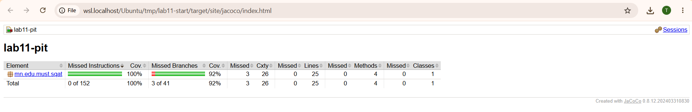
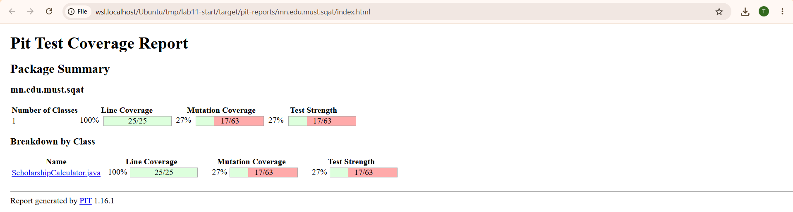
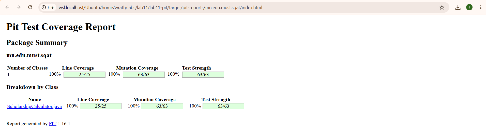

# F.CSA313 Lab 11: Mutation testing (PIT)

- **Нэр:** Ц.Төгөлдөр
- **Оюутны код:** B232270050
- **Хичээл:** F.CSA313 Програм хангамжийн чанар, тестчилгээ (2026)

## Орчин

```
openjdk version "17.0.21.0.3" 2026-10-24
OpenJDK Runtime Environment (build 17.0.21.0.3+1-1-24.04.1-Ubuntu)
OpenJDK 64-Bit Server VM (build 17.0.21.0.3+1-1-24.04.1-Ubuntu, mixed mode, sharing)
```

```
Apache Maven 3.9.11 (3e54c93a704957b63ee3494413a2b544fd3d825b)
Maven home: /mnt/d/Program Files/Apache/Maven/apache-maven-3.9.11
Java version: 17.0.21.0.3, vendor: Ubuntu, runtime: /usr/lib/jvm/java-17-openjdk-amd64
Default locale: en, platform encoding: UTF-8
OS name: "linux", version: "6.18.58.1-microsoft-standard-wsl2", arch: "amd64", family: "unix"
```

## AI ашигласан тухай

Энэ лабораторийн ажлыг гүйцэтгэхэд Claude (AI туслах)-ийг алхам алхмаар заавар өгөх, тестийн кодын ноорог болон README-ийн загвар бэлтгэхэд ашигласан. Бүх командыг өөрийн компьютер дээр өөрөө ажиллуулсан бөгөөд доорх тоо бүр `results/` хавтсын файлуудаас авсан бодит PIT/JaCoCo/Maven үр дүн болно.

## 1. Эхний хэмжилт (Starter)





- JaCoCo: Line coverage 25/25 (100%), Branch coverage 38/41 (`results/jacoco-start.csv`).
- PIT: `>> Generated 63 mutations Killed 17 (27%)` (`results/pit-start.txt`).

Line coverage 100% байсан ч mutation coverage зөвхөн 27% байна. Line coverage нь код ажилласан эсэхийг л хэмждэг бол mutation coverage нь тест кодын өөрчлөлтийг бодитоор илрүүлж чадаж байгааг хэмждэг. Starter-ийн тестүүд зөвхөн `assertNotNull`, утгын мужийн шалгалт хийдэг учир мөр бүрийг ажиллуулсан ч алдааг барьж чаддаггүй байв.

## 2. Part A: Survived mutant-уудын ангилал

Эхний PIT ажиллуулалт: 63 mutation үүссэн, 17 killed, 46 survived (27%). Доорх хүснэгтэд 46 survived mutant-ийг шалтгаанаар нь нэгтгэж бичлээ.

| Мөр | Мутаци (PIT description) | Ангилал | Арга хэмжээ |
|---|---|---|---|
| 20 | changed conditional boundary (`score < 0`, `score > 100`) ×2 | Тест дутуу | -0.01 болон 100.01 оруулахад алдаа гарах тест нэмнэ; одоо зөвхөн -1, 101 шалгадаг тул хил нь шалгагдаагүй. |
| 23 | replaced return value with "", changed conditional boundary, removed conditional (true/false) ×4 | Тест дутуу | 90 → "A", 89.99 → "B" гэсэн яг утгын assert; одоо зөвхөн assertNotNull. |
| 24 | replaced return value with "", boundary, removed conditional (true/false) ×4 | Тест дутуу | 80 → "B", 79.99 → "C" хил болон яг утгын assert. |
| 25 | replaced return value with "", boundary, removed conditional (true/false) ×4 | Тест дутуу | 70 → "C", 69.99 → "D" хил болон яг утгын assert. |
| 26 | replaced return value with "", boundary, removed conditional (true/false) ×4 | Тест дутуу | 60 → "D", 59.99 → "F" хил болон яг утгын assert. |
| 27 | replaced return value with "" | Тест дутуу | 30 болон 0 дээр "F" гэж яг assertEquals хийнэ. |
| 36 | Changed switch default to be first case | Тест дутуу | Equivalent гэж таамагласан боловч B2-ийн PIT-ээр killed болсон тул equivalent биш. Бүх үсэг (A, B, C, D, F) бүхий gpa тестүүд үүнийг илрүүлсэн. |
| 38 | Replaced double addition with subtraction (case "B") | Тест дутуу | Зөвхөн "B" үсэгтэй нэг оноо бүхий gpa (85 → 3.0) тест; одоо range check тул илрэхгүй. |
| 40 | Replaced double addition with subtraction (case "D") | Тест дутуу | Зөвхөн "D" үсэгтэй gpa (65 → 1.0) тест. |
| 44 | replaced double return with 0.0 | Тест дутуу | gpa-ийн яг утга assertEquals(3.5, ..., delta); range check 0.0-г хүлээн зөвшөөрдөг байсан. |
| 48 | changed conditional boundary ×2, removed conditional (true) ×1 | Тест дутуу | gpa 0 ба 4.0 (зөвшөөрөгдөнө), -0.01 ба 4.01 (алдаа), credits 0 тестүүд. |
| 51 | removed conditional (equality check true/false) ×2 | Тест дутуу | `hasViolation = true` үед яг 0 буцаах, `false` үед шагнал олгогдохыг шалгах тест (одоо зөвхөн range check). |
| 52 | replaced int return with 0, boundary ×2, removed conditional ×4 | Тест дутуу | (3.8, 15) → 100, (3.8, 14) → 70, (3.79, 15) → 70 тест. |
| 53 | replaced int return with 0, boundary ×2, removed conditional ×4 | Тест дутуу | (3.4, 12) → 70, (3.4, 11) → 50, (3.39, 12) → 50 тест. |
| 54 | replaced int return with 0, boundary, removed conditional ×2 | Тест дутуу | (3.0, 0) → 50 ба (2.99, 20) → 0 тест. |

## 3. Part B: Тестийг бэхжүүлэх

- **B1:** assert бүрийг яг утгатай (`assertEquals`, `assertThrows`) болгосон. Оролт нь Starter-тэй ижил.
- **B2:** хилийн утгын тестүүд нэмсэн: letterGrade 90/89.99, 80/79.99, 70/69.99, 60/59.99, 0, 100; scholarship-ийн 3.8/15, 3.4/12, 3.0 хил; gpa 0 ба 4, credits 0; gpa-ийн letter бүр.

| Хэмжилт | Файл | Үүссэн | Killed | Mutation coverage |
|---|---|---|---|---|
| Start | `results/pit-start.txt` | 63 | 17 | 27% |
| B1 | `results/pit-B1.txt` | 63 | 45 | 71% |
| B2 | `results/pit-B2.txt` | 63 | 63 | 100% |

Эцсийн Mutation Coverage 100% нь шаардлагатай 85%-иас өндөр. Survived mutant үлдээгүй тул equivalent гэж тайлбарлах mutant байхгүй.



## 4. Part C: Гараар хийсэн mutant

**Mutant 1:** `scholarship()` доторх `gpa >= 3.8` -г `gpa > 3.8` болгосон (`results/mvn-test-manual-mutant.txt`). Тест унасан: `scholarship_boundaries_returnExactPercent`, мөр дээр `expected: <100> but was: <70>`. Яг 3.8 GPA ба 15 кредитийн хилийн тест нь энэ өөрчлөлтийг барьсан. Mutant-ийг `git restore src/main` -оор буцааж, commit хийгээгүй.

**Mutant 2 (equivalent):** line 52 дээрх `gpa >= 3.8 && credits >= 15` -г `credits >= 15 && gpa >= 3.8` болгож операндуудын дарааллыг сольсон. Хоёр нөхцөл хоёулаа зөвхөн утга харьцуулдаг, side effect байхгүй тул `&&`-ийн үр дүн ямар ч оролтод ижил байдаг, иймээс ямар ч тест үүнийг ялгаж чадахгүй. Бүх 36 тест давсан (`results/mvn-test-equivalent-mutant.txt`).

## 5. Дүгнэлт

Line coverage нь тест кодыг ажиллуулсан эсэхийг л хэлдэг бол mutation score нь тест өөрчлөлтийг бодитоор илрүүлж байгааг хэлдэг. Манай Starter тестүүд 25/25 мөрийг хамарсан ч 63 mutant-ийн зөвхөн 17-г (27%) алж чадсан. Үүний шалтгаан нь сул assertion (`assertNotNull`, мужийн шалгалт) болон хилийн утгын тест байхгүй байсан явдал юм. B1-д assertion-уудыг яг утгатай болгоход 71% хүртэл өссөн. B2-д хилийн утгын тестүүд нэмэхэд 100% (63/63) болсон. Бүх mutant killed болсон тул Part A-д equivalent гэж таамагласан mutant ч (line 36) жинхэнэ equivalent биш байсан нь батлагдсан. Иймээс "equivalent" гэсэн дүгнэлтийг PIT-ийн бодит үр дүнгээр баталгаажуулах хэрэгтэй. AI-ийн бичсэн тест ихэвчлэн ажиллах, давах, coverage өндөр харагдах боловч сул assertion агуулж болдог тул mutation score-оор заавал шалгах шаардлагатай.
